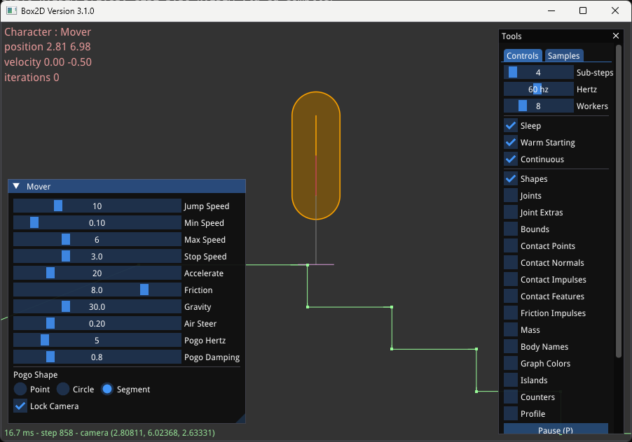
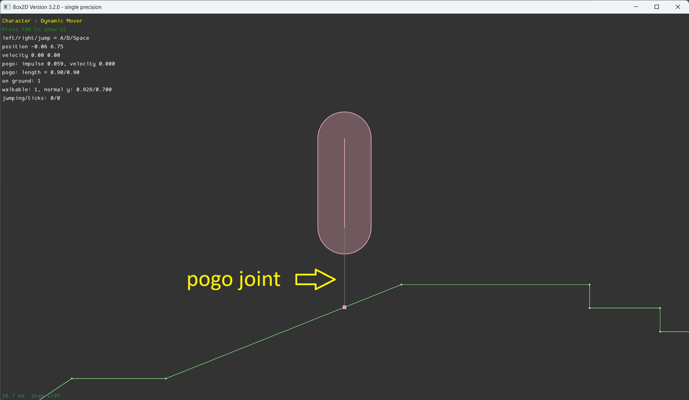

# Character Mover

Character movers are ubiquitous in 2D platformer games. The player moves a character directly with a gamepad or keyboard.

Box2D provides a toolkit for creating movers and not a full implementation. This is intentional because games often
have unique needs for a mover, special movement modes, attachment rules, etc. There is not a one size fits all
solution.

Box2D supports two mover types: geometric and dynamic. Both are experimental because I haven't gotten much
feedback on them.

## Geometric mover

A `geometric` character mover is like a `kinematic` mover except the character mover is
not a rigid body and does not exist in the simulation world. This is done to achieve features that
would be difficult with a kinematic body.

This type of mover may not be suitable for your game. It is less physical than a rigid body, but
it gives you more control over the movement. It is the type of mover you might find
in a first-person shooter or a game with platforming elements.

The mover is assumed to be a capsule. Using a capsule helps keep movement smooth. The capsule should
have a significant radius. It does not have to be a vertical capsule, but that is likely
to be the easiest setup. There is no explicit handling of rotation. But slow rotation can
work with this system.

Let's review the features. First there are a couple world query functions.

### Cast mover

`b2World_MoverCast()` is a custom shape cast that tries to avoid getting stuck when shapes start out touching.
The feature is called _encroachment_. Since the capsule has a significant radius it can move closer
to a surface it is touching without the inner line segment generating an overlap, which would cause
the shape cast to fail. Due to the internal use of GJK, encroachment has little cost. The idea with encroachment is that
the mover is trying to slide along a surface and we don't want to stop that even if there is some small movement into the surface.

### Collide mover

`b2World_MoverCollide()` complements the cast function. This function generates collision planes for touching and/or overlapped
surfaces. The character mover is assumed to have a fixed rotation, so it doesn't need contact manifolds or contact points. It just
needs collision planes. Each plane is returned with the `b2Plane` and a `b2ShapeId` for each shape the mover is touching.

Both mover functions take a `b2Pos` origin and the mover capsule is relative to it. I recommend to assign the mover position to a point
on the capsule axis, such as the bottom of the segment. Another option is to use your game entity position. This is usually on the ground
below the capsule. The returned planes are relative to the mover position and feed `b2SolvePlanes()` directly.

### Solve planes

Once you have some collision planes from `b2World_MoverCollide()`, you can process and filter them to generate an array of `b2CollisionPlane`.
These collision planes can then be sent to `b2SolvePlanes()` to generate a new position for the mover
that attempts to find the optimal new position given the current position.

These collision planes support *soft collision* using a `pushLimit`. This push limit is a distance value. A rigid surface will have a push
limit of `FLT_MAX`. However, you may want some surfaces to have a limited effect on the character. For example, you may want the mover to
push through other players or enemies yet still resolve the collision so they are not overlapped. Another example is a door or elevator
that could otherwise push the mover through the floor.

Finally after calling `b2SolvePlanes()` you can call `b2ClipVector()` to clip your velocity vector so the mover will not keep trying to
push into a wall, which could lead to a huge velocity accumulation otherwise.

### Geometric mover sample

The `GeometryMoverSample` sample shows all these functions being used together. There is a `GeometricMover` you can use as a starting point. It also includes other common character features such as acceleration and friction, jumping, and a pogo stick.

## Dynamic mover

The dynamic mover uses a regular rigid body and moves it around using specialized joint constraints.
By using a rigid body, collisions with other dynamic bodies in the world becomes more natural and
interactive than the geometric mover.

The dynamic mover can use any shape you like, but I recommend sticking with a capsule. However, feel
free to experiment and let me know the results you get.

Since it is a regular rigid body, it automatically gets contact handling and continuous collision detection.
So there is no need for functions to cast or collide like the geometric mover. On the other hand it is
important to have some fine control over the rigid body so it is responsive to player input. For this
I have developed two new joint types that work together: a mover joint and a pogo joint.

### Mover joint

The mover joint is connected between some static ground body and the mover. It is similar to the motor
joint except it only accepts velocity commands. Additionally it has separate x and y maximum force values. This lets the joint use a horizontal force for player control, while letting gravity control the vertical
axis.

### Pogo joint

The pogo joint is a key element of the dynamic mover. It creates a damping spring between the capsule and the ground, smoothing traversal over bumps. This spring is designed to avoid feeding velocity into the rigid body capsule. Also, there are separate limits for compression and tension so it sticks the mover to the ground only when desired.

The pogo is designed to be recreated every time step based on user ray casts. This allows custom filtering, multiple ray casts, etc. The performance impact of recreating the joint is minor since joints are pooled.

### Dynamic mover sample

See the `DynamicMoverSample` for details. There is a `DynamicMover` class that you can use as a starting point. I also made a [video]() that demonstrates the dynamic mover.

## Choosing a mover

I recommend the geometric mover for networked games where rollback is needed. It is also appropriate for games where physics interaction is not desired.

The dynamic mover is aimed at games that want high fidelity physics interactions. I recommend it for single player games because networking detailed physics interactions is challenging.