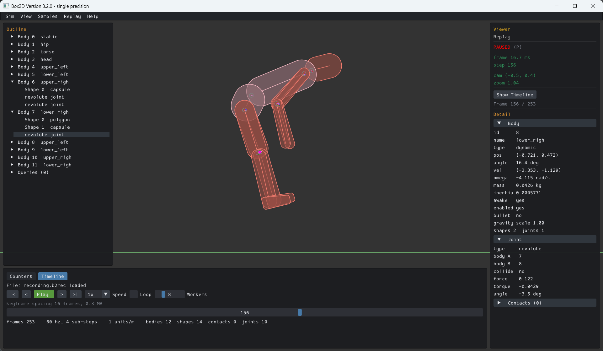

# Recording and Replay {#recording}

Box2D can record a simulation into a memory buffer and replay it later, reproducing the original run
exactly. A recording is a snapshot of the world at the moment recording starts followed by a log of
every world-mutating API call after that. Replaying it re-runs the engine from the snapshot over
those same calls, so the bodies follow the same paths and end up in the same state.

The main use is for debugging. You can record a session, save the buffer to a file, then load it in
the sample app and view the Box2D state as the simulation progresses. You can zip it and upload it
into a GitHub issue to report a bug.

You own the recording buffer. Box2D records into it and grows it as needed. You save it to disk and
free it. You can use the helper `b2Recording_SaveToFile()` to save it to disk.

A recording can start before the first step, capturing the whole session, or mid-session. Either way
the buffer opens with a snapshot of the world as it stands when recording starts, so there is one
code path for both use cases.

## Recording

Create a recording buffer, start recording the world into it, then run the simulation as usual.
Start before the first step to capture everything.

```c
b2WorldId worldId = b2CreateWorld( &worldDef );

b2Recording* recording = b2CreateRecording( 0 );   // 0 = small default capacity
b2World_StartRecording( worldId, recording );       // snapshots the world, then logs calls

// ... create bodies, step the world as usual ...

b2World_StopRecording( worldId );
```

`b2CreateRecording` takes a byte capacity to pre-size the buffer. The buffer grows on demand, so any
value is safe. Pre-sizing just avoids reallocations during a long session. Pass `0` for a small
default.

`b2World_StartRecording` must be called between world steps. It serializes a snapshot of the current
world as the seed, so it works whether you call it before any bodies exist or deep into a running
simulation. It has no effect if the world is already recording.

> [!important]
> Recording doesn't work with pre-solve and custom filtering callbacks. If those are
> installed no recording is generated.

When you are done, save the buffer and free it. File I/O is yours to do. The convenience helper
writes the raw bytes:

```c
b2Recording_SaveToFile( recording, "session.b2rec" );

// or fwrite the bytes yourself:
// const uint8_t* data = b2Recording_GetData( recording );
// int size = b2Recording_GetSize( recording );

b2DestroyRecording( recording );
```

Stopping is optional: `b2DestroyWorld` detaches an active recording for you. The recording buffer
outlives the world, so you can still save it after the world is gone. You can also keep simulating
after `b2World_StopRecording` without recording, and reuse the same handle for a fresh recording
with another `b2World_StartRecording`.

## Snapshots {#snapshot}

A recording starts with a snapshot. It is a serialized image of a world's simulation state between
world steps. It captures everything the engine needs to continue the simulation: bodies, shapes,
joints, contacts with their warm-start impulses, the island and sleep partition, the broad-phase
trees, and the id pools. It is a lot of data. It does not capture host wiring (worker count, task
callbacks, user data, the friction and restitution mixers). That is rebuilt or reinstalled at
restore.

Snapshots are available directly, without recording, as a public API for save states and rollback:

```c
// Serialize: query the size, then fill a buffer you own.
int size = b2World_GetSnapshot( worldId, NULL, 0 );
uint8_t* image = malloc( size );
b2World_GetSnapshot( worldId, image, size );

// ... keep simulating ...

// Restore the same world in place. Ids you held at the snapshot instant keep working.
b2World_RestoreFromSnapshot( worldId, image, size );

// Or load the image into a brand new world. The new world has a fresh id, so origin ids
// do not match it, and its host wiring is reset to defaults.
b2WorldId loaded = b2CreateWorldFromSnapshot( image, size, /*workerCount*/ 0 );
```

`b2World_RestoreFromSnapshot` keeps the world's slot and generation, so the `b2WorldId` and every
`b2BodyId` / `b2ShapeId` / `b2JointId` / `b2ChainId` you held at the snapshot instant resolve again.
Ids created after the snapshot will fail validation after a restore rather than aliasing a different
object (thanks to a generation number). `b2CreateWorldFromSnapshot` allocates a new world, so use it
only when there is no existing world to restore into.

You can validate your snapshot workflow using `b2World_GetStateHash()`. This function also might be
useful for determining if rollback is needed in client prediction scenarios.

Like recording, snapshots are worker-count independent: a world snapshotted single-threaded restores
and continues with any worker count.

> [!note]
> Snapshots are considered experimental and may change in the future as the system is optimized.

## Viewing a recording

The samples app has a **Replay** menu you can use to open a recording.

- Replay loads a `.b2rec` into a buffer and plays it back using a `b2Replay` struct. It supports
  play, pause, single-step, restart, and camera control. A `DIVERGED` overlay appears if a recorded
  state hash fails to reproduce, which is a real determinism break, not a viewer bug.
- Look at the samples app help menu for shortcuts.

[{html: width=100%}](replay_viewer.png)

You can pass the recording on the command line, which boots the samples app into the viewer with the
file pre-loaded:

```sh
samples path/to/my_recording.b2rec
```

There is a public replay API, but that is there to be used by the samples app. Advanced users can
look at the replay viewer for details.

## Determinism

Replay is only guaranteed to reproduce the original only when the Box2D source is identical for the
recorder and player. It is possible it could work across different source builds, but that is going
to be luck. Additional caveats:

- **Struct layout** is enforced. A recording opens by deserializing a snapshot, which is a raw
  struct image, so the writer and reader builds must have identical struct layouts. The snapshot
  carries a layout hash that is validated before loading continues. A mismatch stops the load.
- **Floating-point environment** must match. Box2D builds with `-ffp-contract=off` so fused
  multiply-add does not change results. Building with `-ffast-math` is unsupported. The writer and
  reader builds must use the same [floating point precision](@ref large-worlds).

## Spatial queries

Overlap and cast queries issued during a recording (ray casts, shape casts, overlap tests, and the
character mover casts) are recorded too. On replay each query is re-issued against the replayed
world and its results are compared against what was recorded, so a query that returns different hits
is flagged like any other divergence. This is visualized in the replay viewer.

## Limitations

- **Recordings require a matching struct layout.** A recording is seeded by a raw struct-image
  snapshot gated on an exact layout hash, so it will not load into a build whose internal layout
  changed, even if the float environment and architecture match.
- **User data is not preserved.** `userData` pointers are host addresses with no meaning in the
  replay process, so they are written as zero. Code that keys off user data during replay will not
  see the original pointers.
- **Friction and restitution callbacks must be reinstalled.** These mixers are pure functions of
  their inputs, so their results are not recorded. To replay a session that used a custom mixer,
  install the same mixer on the replay host. The defaults need nothing.
- **preSolve and customFilter callbacks are not supported while recording.** They carry user context
  and can change the simulation. Using these will lead to divergence. However, these should work in
  a snapshot setup that uses identical callbacks.

